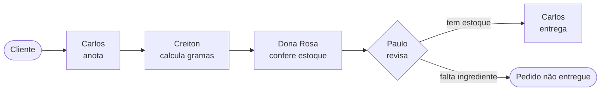
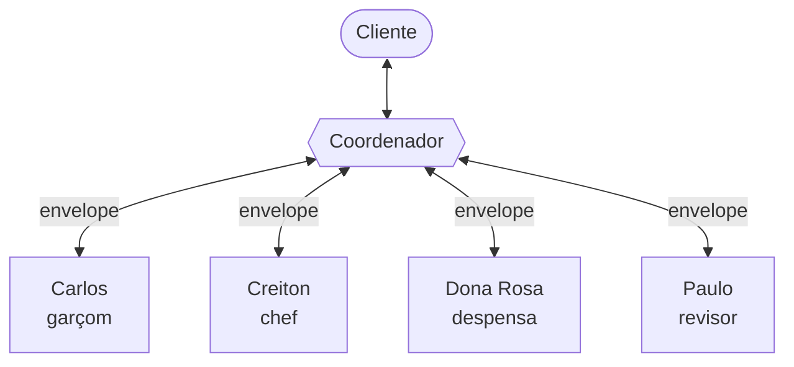

# 🍽️ Cozinha do Creiton — Sistemas Multiagentes com LangChain


Atividades do **Módulo 4 – Sistemas Multiagentes** da AIX Academy · FPFtech.

Um restaurante fictício em que cada funcionário é um agente de IA com seu papel, seu prompt e suas ferramentas. O pedido do cliente passa pelo garçom, pelo chef, pela despensa e pelo revisor até ser entregue na mesa ou recusado por falta de estoque. Tudo roda **localmente**, com um modelo pequeno (`qwen2.5:3b`) no Ollama.

## 👥 A equipe

| Agente | Papel | Ferramenta |
|---|---|---|
| **Carlos** | Garçom: anota o pedido do cliente e, se aprovado, entrega o prato | `formata_pedido` |
| **Creiton** | Chef: calcula quantos gramas o pedido precisa | `calcular_porcoes` |
| **Dona Rosa** | Despensa: confere se o estoque dá conta | `calcular_estoque` |
| **Paulo** | Revisor: aprova a entrega ou encerra o pedido | — |
| **Coordenador** | *(atividade 2)* Recebe toda mensagem e decide para quem vai o próximo envelope | uma tool por destinatário |

As contas ficam em Python, dentro das tools: os agentes só pedem a chamada. Assim, um número errado no texto do modelo não estraga a decisão.

## 📒 Atividades

### Atividade 1: equipe em sequência · [`Modulo_4_atividade_1.ipynb`](exercicios/Modulo_4_atividade_1.ipynb)

O código define a ordem das etapas. O texto (e os valores das ferramentas) de cada agente entra na mensagem do próximo. O Carlos só é chamado de novo, pela tool `entregar_comida` do Paulo, se houver estoque para entregar.



### Atividade 2: coordenador e envelopes · [`Modulo_4_atividade_2.ipynb`](exercicios/Modulo_4_atividade_2.ipynb)

Nenhum agente fala direto com outro. Toda mensagem, do cliente ou de um agente, vai para o **coordenador**, que decide quem é o próximo e **cria o envelope** (`remetente`, `destinatario`, `conteudo`) com uma das suas tools. Cada agente só abre envelopes endereçados a ele. O atendimento é um loop: um pedido novo só é aceito quando o anterior volta ao cliente.



Exemplo real de um atendimento:

```text
_Cliente: assado de panela pra 14 pessoas na mesa 2
_Coordenador: envia para Carlos
_Carlos: Pedido anotado: M02, assado de panela, 14 pessoas.
_Coordenador: envia para Creiton
_Creiton: Total: 2100 g de assado de panela para a mesa M02.
_Coordenador: envia para Dona Rosa
_Dona Rosa: Estoque insuficiente: faltam 1100 g de assado de panela para a mesa M02.
_Coordenador: envia para Paulo
_Paulo: Pedido encerrado: o assado de panela da mesa M02 não será servido hoje.
_Coordenador: envia para Cliente
Conferência: ok
```

No fim de cada pedido, a **conferência** checa o resultado pelos valores que as ferramentas devolveram (total, sobra do estoque, entrega ou recusa), e não pelo que os agentes escreveram.

## 🧠 Aprendizados com um modelo de 3B

Um modelo pequeno erra de jeitos bem específicos. Boa parte do trabalho foi medir esses erros e desenhar o sistema em volta deles:

- **`temperature=0`**: com `1`, os agentes pulavam a chamada das ferramentas.
- **Respostas com formato fixo** (`"Pedido anotado: ..."`, `"Total: ..."`, `"Proposta: ..."`): sem isso, a Dona Rosa confundia "o que separar" com "o que sobra".
- **Uma tool por destinatário no coordenador**: com uma tool genérica `enviar_envelope(destinatario, conteudo)`, ele errava quase todas as rotas; com uma por agente, acertou 10 de 10 nos testes.
- **Palavras importam**: mensagens com `FALTA_INGREDIENTE` e `REPROVADO` eram roteadas de volta para quem as escreveu; trocando por `Estoque insuficiente` e `Pedido encerrado`, o roteamento acertou tudo.
- **Ordem das regras no prompt**: quando a regra de entrega era uma "exceção" no fim do prompt do Carlos, ele anotava a aprovação do Paulo como se fosse um pedido novo.

## 🚀 Como rodar

Pré-requisitos: Python 3.12+ e o [Ollama](https://ollama.com/download) instalado.

```powershell
# 1. modelo local
ollama pull qwen2.5:3b

# 2. ambiente Python
python -m venv .venv
.venv\Scripts\activate
pip install -r requirements.txt
```

3. Crie um `keys.env` na raiz (ele está no `.gitignore`):

   ```env
   OLLAMA_BASE_URL=http://localhost:11434
   OLLAMA_MODEL=qwen2.5:3b
   ```

4. Abra um notebook de `exercicios/`, escolha o kernel do `.venv` e rode: a célula de preparo, o passo 1, a célula da cozinha e, por último, a de atendimento. Ela pede o pedido no `input()`, por exemplo `Mesa 4 quer arroz de carreteiro para 5 pessoas`; Enter vazio encerra.

> **Versões fixas.** A célula "Preparar o Colab", que veio do material da aula, confere as versões exatas de `langchain`, `langchain-core`, `pydantic`, `langchain-ollama`, `langgraph` e `ollama` e para se forem diferentes. O `requirements.txt` já está nessas versões.

> **Colab x local.** O material original da aula roda no Google Colab com o Ollama na nuvem. Nos meus notebooks, o passo 1 foi trocado para ler o `keys.env` e usar o Ollama local, sem chave. O `ChatOllama` usa a URL **sem** `/v1`.

## 📁 Estrutura

```text
ax_academy_multiagent_module/
├── aulas/          Slides da aula
├── exemplos/       Notebook-base disponibilizado na aula
├── exercicios/     Minhas atividades (atividade 1 e 2)
├── requirements.txt
└── keys.env        Configuração do modelo local (não versionado)
```

---

Feito por [@levicavalcante07-svg](https://github.com/levicavalcante07-svg) durante a AIX Academy · FPFtech. As propostas, reservas e entregas do restaurante são fictícias.
